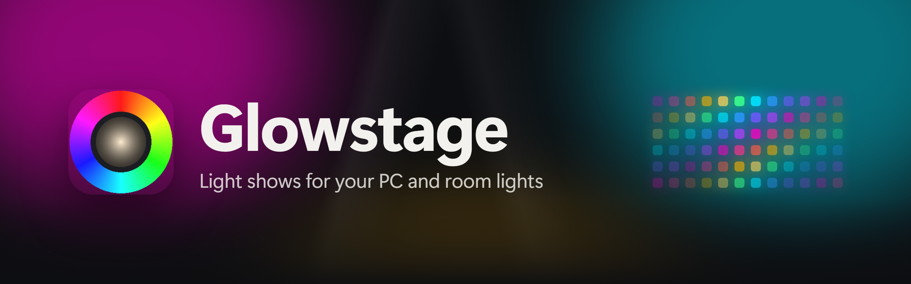
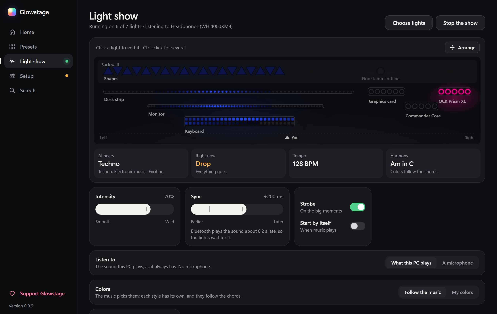
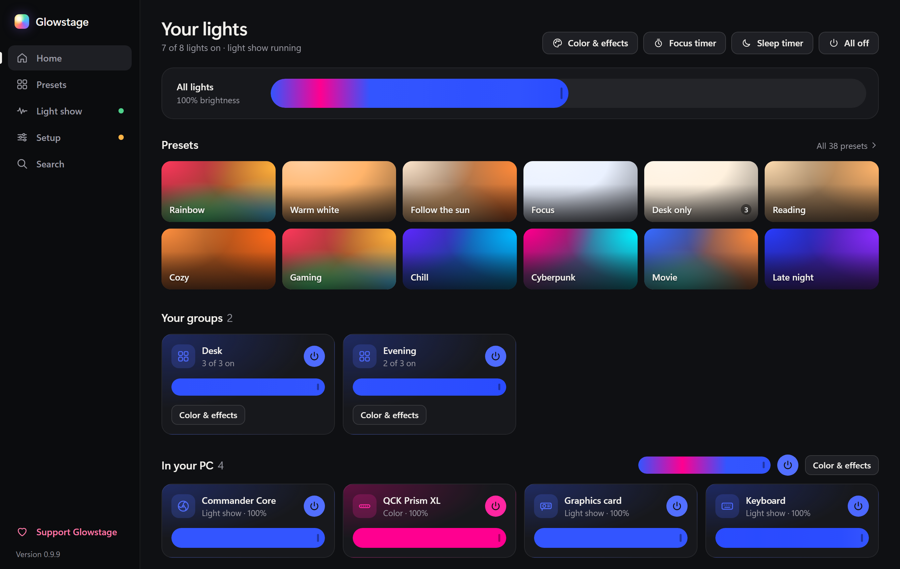
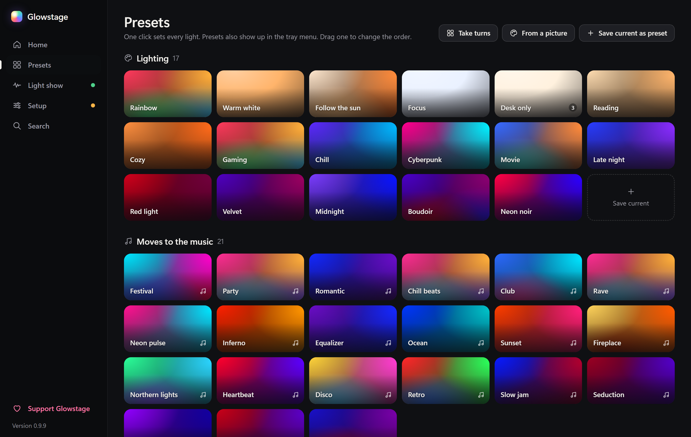

<p align="center">
  
</p>

<p align="center">
  <a href="https://github.com/BDSuspiciouS/glowstage/releases/latest"></a>
  <a href="https://github.com/BDSuspiciouS/glowstage/releases"></a>
  
  <a href="LICENSE"></a>
  <a href="#support-glowstage"></a>
</p>

<p align="center">
  <b>Turn your room into a stage.</b> Glowstage drives your PC's RGB, your LED strips and your smart lights together<br>
  and puts on a festival-style light show to whatever your PC plays: Spotify, YouTube, games.<br>
  No microphone, no cloud, no account. Free and open source.
</p>

<p align="center">
  <a href="https://github.com/BDSuspiciouS/glowstage/releases/latest"><b>⬇&nbsp; Download for Windows</b></a>
  &nbsp;·&nbsp; <a href="#supported-lights">Supported lights</a>
  &nbsp;·&nbsp; <a href="#support-glowstage">Support the project</a>
</p>

<p align="center">
  
</p>

## What it does

- **A real light show, not a VU meter.** A virtual lighting operator locks onto the beat, counts bars and phrases, hears build-ups coming, holds its breath before the drop and hits it on the one. It learns the song while it plays, so the second chorus looks like the first. Tuned on an hour of real house, afro, amapiano, rap and pop. Switch on *Start by itself* and it begins when music plays and hands your lights back when it stops.
- **It knows what it's listening to.** An offline AI recognises the genre (built in, or with one click an enhanced AI that knows 400 music styles) and every genre gets its own choreography: step chases for techno, a disco floor for house, everything glowing with the 808 for hip-hop, slow washes for chill. Colors follow the chords.
- **One stage for the whole room.** Chases run from the strip above your monitor over the keyboard to the fans in your case. Drag lights into place on the stage, and choose which ones join the show.
- **Lights that follow your screen.** With Screen sync every light takes the part of the picture where it sits: the strip above your monitor runs along with a film or a game from left to right, a bulb takes the screen's color as a whole.
- **Your room plays along with Counter-Strike 2.** Your team's color, your health as a bar across the lights, white when you're flashed, the bomb blinking ever faster, a pop for every kill. It uses Valve's own game state integration, so nothing touches the game and it's safe for VAC (Setup → Games).
- **Your keyboard ripples as you type.** With *Typing ripples* every key you press lights up and sends a ripple across the keyboard, and your other lights glow where the key sits. It only looks at which key is down while the look runs, and keeps and sends nothing.
- **Light that follows the sun.** *Follow the sun* lights your room like the day outside: cool and bright at noon, golden as the sun sets, warm in the evening and a low amber glow at night. It knows when the sun rises and sets where you live from Windows' region setting, without location access or the internet.
- **Presets for every moment.** Focus, Reading, Cozy, Gaming, Movie and more, each lighting your PC and your room its own way. Save your own with one click, run them from the tray or a hotkey, on a schedule (*Late night* at 23:00, everything off at 1:00), or automatically: *Gaming* when a game goes full screen, *Movie* for a full-screen video, and back to your own look afterwards.
- **Lights off when you step away.** Lock the PC, let its screen go off or put it to sleep, and the PC's lights (or all of them) switch off; they come back as they were when you return (Setup → Automatic).
- **In sync with what you hear.** Bluetooth headphones play the sound later than your PC sends it; Glowstage notices and waits for them. Slow lights (Hue, Govee, Home Assistant) get calmer looks that still catch every hit.
- **Works out of the box.** A short welcome tour finds your lights, fetches OpenRGB for the RGB inside your PC if you want it, and gets you to your first light show in a minute. It lives quietly in the tray.

<p align="center">
  
  
</p>

## Supported lights

| Lights | How |
|---|---|
| Motherboards, RAM, GPUs, coolers, fans, keyboards, mice, mousepads, headsets: the 300+ devices [OpenRGB](https://openrgb.org) supports | OpenRGB's SDK server, started by Glowstage (the welcome tour can download it for you) |
| [WLED](https://kno.wled.ge) strips and matrices | Found automatically; realtime streaming at up to 50 fps |
| Nanoleaf (Shapes, Canvas, Light Panels, Lines, Elements) | Found automatically; press Pair and hold the power button |
| ASRock Radeon graphics cards (not supported by OpenRGB) | Directly over the card's I2C bus |
| QMK keyboards that speak SignalRGB's protocol (e.g. MCHOSE GX87), per key | Directly over USB |
| Philips Hue *(beta)* | Bridge found automatically; press the link button, then Pair |
| LIFX *(beta)* | Found automatically |
| Govee *(beta)* | Found automatically once LAN Control is on in the Govee Home app |
| Yeelight *(beta)* | Found automatically once LAN Control is on in the Yeelight app |
| Elgato Key Light and Light Strip *(beta)* | Found automatically |
| Twinkly *(beta)* | Found automatically; realtime streaming |
| Magic Home / Flux LED Wi-Fi controllers *(beta)* | Found automatically |
| Anything in Home Assistant *(beta)* | Add your Home Assistant address and a long-lived access token |
| DMX stage lights over Art-Net or sACN *(beta)* | Art-Net nodes found automatically; patch your fixtures in Setup |

Lights marked *beta* are new and haven't been tested on every model. If yours misbehaves, or isn't on the list, please [open an issue](https://github.com/BDSuspiciouS/glowstage/issues/new/choose).

## Install

1. Download `Glowstage-x.y.z-windows.zip` from the [latest release](https://github.com/BDSuspiciouS/glowstage/releases/latest).
2. Unzip it anywhere (your Documents is fine) and run `Glowstage.exe`. It adds itself to the Start menu.
3. The welcome tour finds your lights. Open **Light show**, press **Start the show** and play some music.

Windows 10 or 11, 64-bit. Windows may say the app is from an unknown publisher, because it isn't code-signed (that costs money every year): choose *More info → Run anyway*. When a new version is out, Glowstage tells you and updates itself with one click: it gets the new version from this page, checks it against the checksum GitHub lists, and restarts.

## Support Glowstage

Glowstage is free, has no ads and collects nothing about you. It's made by one person, in spare time. If it brings your room to life, a donation keeps it going: support for more lights, better light shows, fixes.

<p>
  <a href="https://github.com/sponsors/BDSuspiciouS"></a>
</p>

Free ways to help: give the project a ⭐, tell a friend, or [report a bug or an idea](https://github.com/BDSuspiciouS/glowstage/issues/new/choose). Thank you!

## Questions

<details>
<summary><b>The lights run a little ahead of (or behind) the music</b></summary>

Open **Light show** and move **Sync**. Bluetooth headphones and speakers are detected and get about 0.2 s on their own; Remote Desktop and some speakers need a nudge. The setting is remembered per sound output.
</details>

<details>
<summary><b>The light show doesn't react</b></summary>

Glowstage listens to the sound your PC plays on its default output (no microphone). Check that the music plays on that output, and that the player itself isn't muted. A player turned far down still works.
</details>

<details>
<summary><b>My PC's RGB doesn't show up</b></summary>

The RGB inside your PC goes through OpenRGB. Setup → PC lighting can download it and start it for you; some motherboards and RAM only show up when OpenRGB runs as administrator (a switch in the same place). See the [hardware notes](docs/HARDWARE.md).
</details>

<details>
<summary><b>Glowstage froze or closed</b></summary>

It writes down where it was in `%APPDATA%\Glowstage\hang.log` (when it stops responding) and `crash.log`. Please attach those and `glowstage.log` to a [bug report](https://github.com/BDSuspiciouS/glowstage/issues/new/choose).
</details>

<details>
<summary><b>Is the Counter-Strike 2 lighting safe for VAC?</b></summary>

Yes. It uses Valve's own game state integration, the feature RGB makers and stream overlays use: CS2 itself sends what happens in the match to Glowstage on your PC. Nothing reads the game's memory or changes the game. Connecting puts one small text file (`gamestate_integration_glowstage.cfg`) in CS2's cfg folder; Disconnect removes it.
</details>

<details>
<summary><b>What does Glowstage send over the internet?</b></summary>

Your lights are controlled on your own network. Once a day Glowstage asks GitHub whether there's a new version and where people can support the project (two public files; nothing about you is sent; you can switch it off in Setup). OpenRGB and the enhanced genre AI are only downloaded when you ask for them, from their makers.
</details>

## For developers

```
python -m pip install -r requirements.txt
python -m glowstage
```

Python 3.12. `tools\build.ps1` builds `Glowstage.exe` and the release zip on your own PC. To work on the interface in a browser with sample lights, serve `glowstage/ui` (`python -m http.server --directory glowstage/ui`) and open it. `tools/show_bench.py` replays recorded songs through the light show and measures how it does, see [the light show in detail](docs/LIGHT-SHOW.md).

## License

Glowstage is licensed under the [GNU General Public License v3.0](LICENSE). It uses OpenRGB (GPL-2.0) as a separate program, and the YAMNet model (Apache-2.0) with AudioSet labels (CC BY 4.0) by Google. The enhanced genre AI, Discogs-EffNet by the Music Technology Group (Universitat Pompeu Fabra), is not part of Glowstage: when you ask for it, Glowstage downloads it from its makers, under its own license (CC BY-NC-SA 4.0, non-commercial use).
